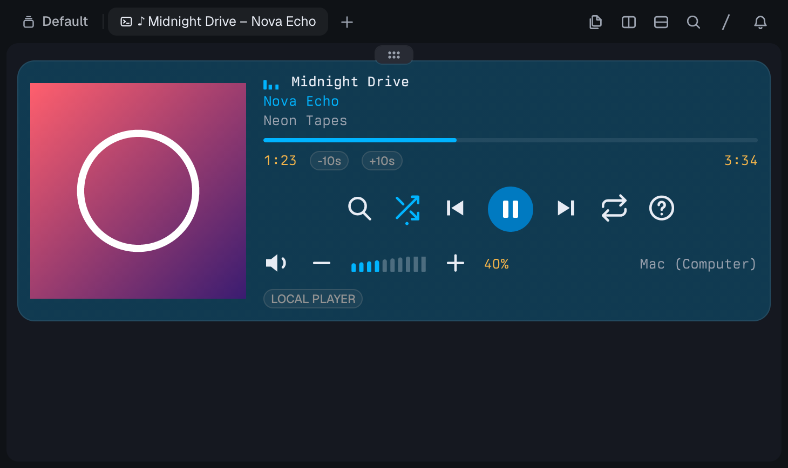
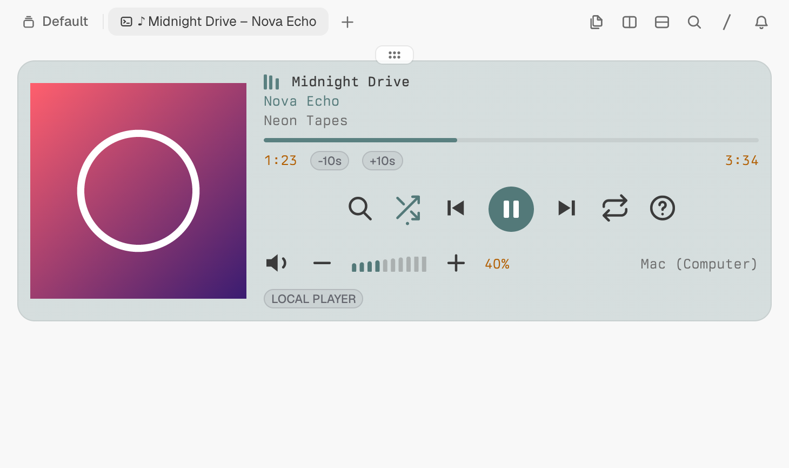
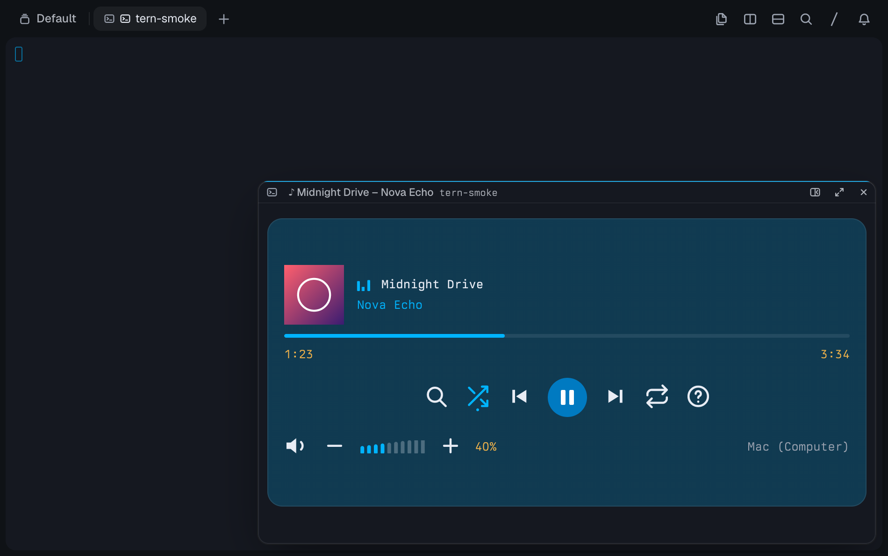
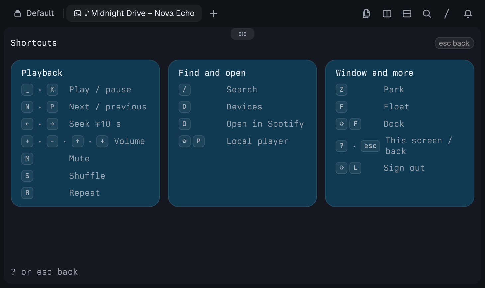
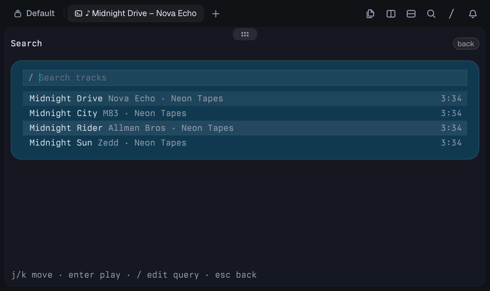
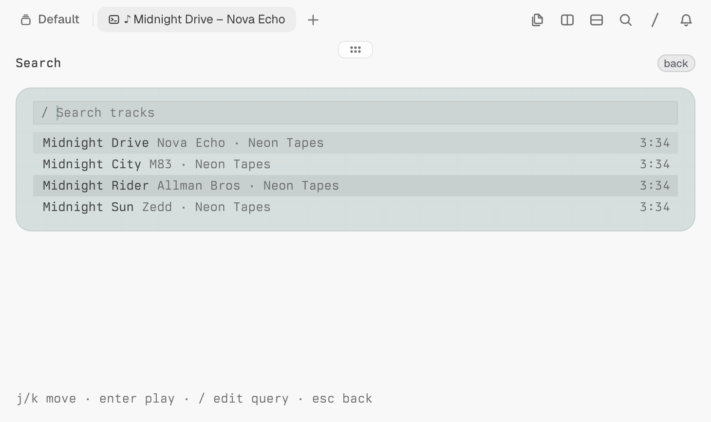
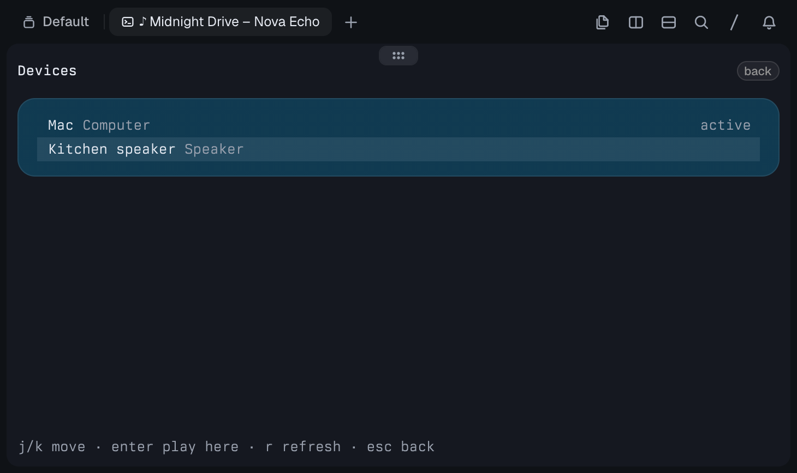
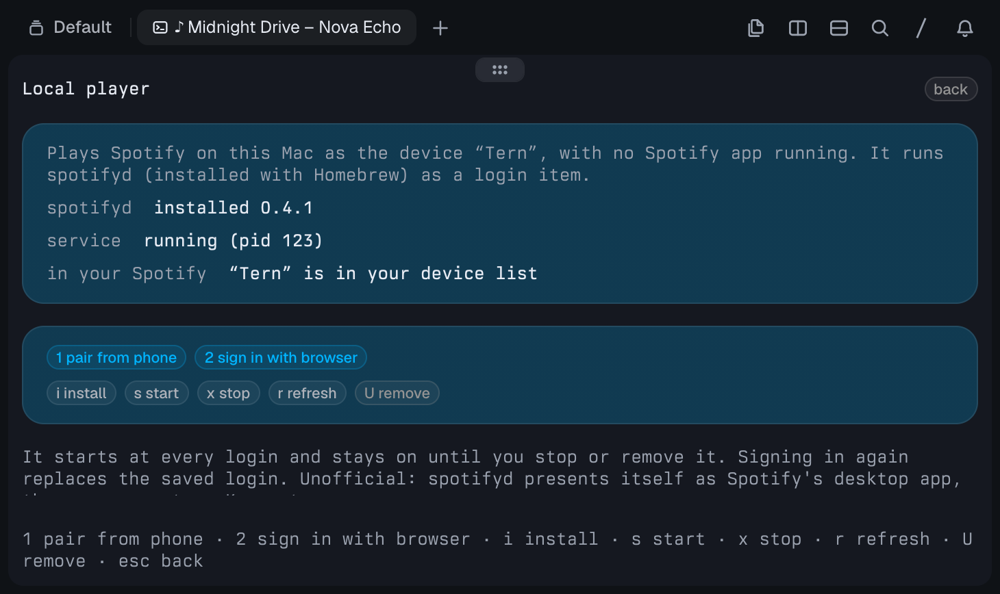

# Warble: Spotify for Tern

A Spotify player block for [Tern](https://stencil.so/tern) that talks to the Spotify Web API directly
(Authorization Code + PKCE). It controls any Spotify Connect device (the desktop app, your phone, a speaker,
or a headless `spotifyd`): cover art, SVG transport controls in the terminal's
theme colours, a progress bar, seek, volume, shuffle/repeat, a device picker and track search. It plays no audio itself; an
optional [local player](#local-player-play-on-this-mac-with-no-spotify-app) installs `spotifyd` so this Mac
can be the device.

> **Platform: macOS only for now** (tested on Apple Silicon with Tern 0.9.5). Support for Linux and other
> environments is planned; the Web API half is plain Luau plus `sh`/`nc`, but nothing outside macOS has been run,
> and the local player depends on Homebrew and launchd. Warble's plugin id is `spotify-api`.

> **Requires Spotify Premium.** Spotify only lets Premium accounts control playback through its API. With a
> free account you can sign in, but every playback command fails. This is true for both ways of signing in.

## Screenshots

Rendered in an isolated Tern with fixture data (a made-up track and a drawn cover, no real Spotify session).

| Docked, dark | Docked, light |
|---|---|
|  |  |

| Floating card | Shortcuts (`?`) |
|---|---|
|  |  |

| Search, dark | Search, light |
|---|---|
|  |  |

| Devices | Local player |
|---|---|
|  |  |

## Two ways to sign in

| | Your own Client ID (recommended) | Keymaster (unofficial) |
|---|---|---|
| What it is | A free app you register at developer.spotify.com | The client ID of Spotify's own desktop app, the one librespot and spotifyd present themselves as |
| Setup | About two minutes, once | None |
| Within Spotify's terms | Yes | No: it likely breaches them |
| Risk | None beyond normal use | Yours: Spotify can block or change that ID at any time, and it is shared with everyone who uses it |
| Users | Development Mode: 5 per app, each added under *User Management*; the app's owner needs Premium | Not tied to an app of yours |
| Redirect | `http://127.0.0.1:43821/callback`, which you register | `http://127.0.0.1:8000/login`, handled for you |
| Permissions asked | Read playback state, control playback | The same two |

The block asks you to choose the first time it opens (`1` or `2`) and shows a warning you must accept before
Keymaster signs in. **Keymaster is new: it has been exercised against a simulated Spotify, not yet confirmed end
to end against Spotify's real servers.** Everything else in this README uses the first option.

## Requirements

- A Spotify **Premium** account, for either way of signing in.
- **For your own Client ID**, a free Spotify app registered at <https://developer.spotify.com/dashboard>:
  1. Create an app (any name). Tick **Web API**.
  2. Add this **Redirect URI**, exactly: `http://127.0.0.1:43821/callback`
  3. Copy its **Client ID**.

  Development Mode apps stop working when the app owner's Premium lapses, and allow 5 users: add anyone else
  under *User Management*.
- **For Keymaster**, nothing to register. Read the warning the block shows.
- **macOS** on the machine that runs Tern's daemon (a phone or a remote host only shows the pane). Sign-in uses
  `sh`, `head`, `base64`, `tr` and `nc` (BSD netcat), and the refresh token goes in the login Keychain through
  `security`; all part of macOS.
- [**Tern**](https://stencil.so/tern) with plugin support (`tern plugin ...`); 0.9.5 was used.
- **Optional, for the local player:** [Homebrew](https://brew.sh). Warble installs `spotifyd` with it for you.

## Install

1. Install the plugin:

   ```sh
   tern plugin install github.com/ElkinAMG/tern-warble
   ```

   Or from a clone: `git clone https://github.com/ElkinAMG/tern-warble && tern plugin install ./tern-warble`.
   To hack on it in place use `tern plugin link ./tern-warble` instead. Check with `tern plugin list`: the
   `spotify-api` line must end in `ready`.
2. Pick how to sign in (see [Two ways to sign in](#two-ways-to-sign-in)). The recommended one takes about two
   minutes: register a free app at <https://developer.spotify.com/dashboard>, add the Redirect URI
   `http://127.0.0.1:43821/callback` and copy its Client ID.
3. Open the command palette (`⇧⌘P`) and run **New Spotify (Web API) block**. Choose `1` (your own Client ID) or
   `2` (Keymaster), and sign in.
4. **Optional, to play audio on this Mac with no Spotify app:** press `P`, then `i`. That runs `brew install
   spotifyd` for you; then `1` (pair from your phone) or `2` (sign in with the browser), which starts it once
   the login works. See [Local player](#local-player-play-on-this-mac-with-no-spotify-app).

Update with `tern plugin install github.com/ElkinAMG/tern-warble --force` (never replaces a linked copy);
remove with `tern plugin remove spotify-api`.

**Why spotifyd is installed, not bundled.** Its macOS release binaries did not run here without Homebrew's
libraries (see the local player section), and shipping a GPL-3.0 program inside this MIT repository would bring
the GPL's obligations (licence text, source offer) with it. So its code and binaries are not in this repository;
the plugin automates the install instead, so there is nothing for you to build. It does need Homebrew.

### Signing in, details

Open the command palette (`⇧⌘P`) and run **New Spotify (Web API) block**. On first use choose how to sign in
(`1` your own Client ID, `2` Keymaster). For your own, paste the Client ID (or set `SPOTIFY_CLIENT_ID` in the
daemon's environment, which always selects it), press Enter, then **Sign in**: Tern opens Spotify's consent
page through its link routing (its built-in browser pane unless you routed links elsewhere) and the redirect
is caught on `127.0.0.1:43821` (`127.0.0.1:8000` for Keymaster). After **Sign out** (`L`), `e` on the sign-in
screen changes the way you sign in; a token from one way is never reused with the other, nor with a different
Client ID. If Spotify keeps refusing (a rate limit, no network) the block stays on "Connecting to Spotify" and
shows why; `e` or `esc` there opens the same choice without signing you out, `esc` from the choice goes back
to trying, and `L` signs out.

If the browser can't reach the machine running the pane (a remote host), press `c` to copy the
sign-in URL, open it anywhere, and paste the address you end up on (it will fail to load; that's
fine) back into the block.

## Keys

| Key | Action |
| --- | --- |
| `space`, `k` | Play / pause |
| `n` / `p` | Next / previous |
| `←` `→` | Seek ∓10 s |
| `+` `-` (or `↑` `↓`) | Volume ±5 |
| `m` | Mute / restore |
| `s` / `r` | Shuffle / cycle repeat |
| `/` | Search tracks (`enter` search, `↓` results, `enter` play, `esc` back) |
| `?` | Shortcuts: every key, in groups (`?` or `esc` closes it) |
| `d` | Pick a playback device |
| `o` | Open the track in Spotify |
| `P` | Local player: play on this Mac with no Spotify app (see below) |
| `z` | Park the player (sends it to the pile; it keeps running) |
| `f` | Float the player: a small card over your panes, keyboard stays on it |
| `F` (shift+f) | Dock the player into a normal split |
| `L` | Sign out |

Keys go to the focused pane. Opening the player, **Show player**, `f` and `F` all leave the keyboard on
the player, so you can press the next key straight away; Tern grows a focused card while you use it and
shrinks it when you focus something else. `z`, `f` and `F` are carried out by the window half (the block only
passes them on), and only once Spotify is connected and no text field has the keys (not while typing a search). Each
names a target state (park, float, dock) instead of toggling, so pressing it twice, or in a session
shown in several windows, ends in the same place; several windows are untested. From the pile use
**Show player** (or `⌃⇧↑`) to bring it back. Every control is also clickable (see below).

## The player

- **Controls** are SVG icons in one row: search (same as `/`), shuffle, previous, a play/pause disc, next,
  repeat (the repeat icon shows a `1` for repeat-one) and `?` (opens the shortcuts screen). An icon that is on is drawn in the theme's accent colour **and** has a dot
  under it, so the state does not depend on colour alone. The docked view adds `−10s`/`+10s`. The docked and floating-with-focus views add the speaker (mutes; `−`/`+` step the volume by 10, the keys by 5), the ten-step meter and the device name (opens the
  picker). A parked or unfocused card shows the meter, the level and the device without buttons (the pointer stays an arrow there). `←`/`→` seek in the docked and floating-with-focus views. Icons are drawn in `currentColor` (the theme's text colour); the accent
  and the disc's fill come from the theme's CSS variables, with a white glyph on the disc.
- **The progress bar** is a plain native bar of the playback position. Clicking it does not seek: Tern's docs give a block no pointer position, so use `←`/`→` (or `−10s`/`+10s` where shown).
- **The equaliser** next to the title, in the theme's accent colour, dances while a track plays and sits flat when it does not. It is CSS
  (`spotify.css`), so it costs no re-render, and it stops if your system asks for reduced motion.
- **Attribution.** The `OPEN SPOTIFY` badge, the cover art (click it) and the `o` key open the track in
  Spotify, as Spotify's developer policy asks of apps that show its metadata and cover art. The cover art
  is not cropped and nothing is drawn over it (Tern itself rounds raster corners by 6 px). The plugin does
  not draw Spotify's logo; the logo comes with brand-asset terms of its own.
- Each picture is sent to Tern once (`cx:blob`) and its id is reused. SVG icons are cached by content for the block's life; the cover blob is replaced per track. Whether Tern frees the old blobs, or keeps an id valid for as long as the block runs, was not verified.

## Local player (play on this Mac, with no Spotify app)

Press `P` (or click **LOCAL PLAYER**) while signed in. It manages [spotifyd](https://github.com/Spotifyd/spotifyd)
so that this Mac shows up in Spotify Connect as the device **Tern** and plays audio itself. It needs macOS and
[Homebrew](https://brew.sh); on the Mac that runs Tern's daemon (a phone only shows the block).

- **Install (`i`).** Runs `brew install spotifyd`. Nothing from spotifyd is in this repository: it is GPL-3.0
  (this plugin is MIT). The v0.4.2 macOS binaries on its GitHub release don't replace Homebrew either: the
  `default` build died with `dyld: Library not loaded: /opt/homebrew/opt/dbus/...` where Homebrew's dbus
  was missing, and the `slim` one links `/opt/homebrew/opt/portaudio` (`otool -L`). Homebrew verifies its
  own bottle's checksum.
- **Two ways to sign spotifyd in** (the login is cached after the first connection). Each one writes to a
  *staging* folder and only replaces the working login once it has worked, so a failed or cancelled attempt
  never costs you the login you had (the agent that was running is brought back). The swap itself moves the
  old login aside, moves the new one in and only then deletes the old one; if either move fails the old one
  is put back. A sign-in counts only when its `credentials.json` is there: `oauth/credentials.json` for the
  browser route ([spotifyd's docs](https://docs.spotifyd.rs/configuration/auth.html)) and
  `zeroconf/credentials.json` for pairing. An empty `oauth/` (made when `authenticate` starts) or a lone
  `volume` file is not a login, and a browser sign-in that exits without one is refused:
  1. **Pair from the phone (`1`).** spotifyd runs for at most 3 minutes with discovery on; open Spotify on
     your phone (same Wi-Fi), tap the device icon and choose **Tern**. Anyone else on your network could
     answer first, so it counts only when a login has been written here **and** Tern is listed in *your*
     account's devices. Then the pairing run is stopped, the login replaces the old one, and the supervised
     service takes over with discovery off. Otherwise the staging login is wiped. A second Mac or a stale
     entry also called "Tern" can't be told apart by name alone, which is why the login on disk is required.
  2. **Sign in with the browser (`2`).** Runs `spotifyd authenticate` (listens on `127.0.0.1:8000`, its
     default port), opens the address in your browser and waits up to 3 minutes. A Keymaster sign-in is
     refused while this one holds the port.

  Both make spotifyd present itself as Spotify's own desktop app, so the Keymaster caveat above applies:
  it is unofficial and against Spotify's terms. The pairing and browser runs are stopped with `pkill -f` on
  their own staging path, which nothing else has on its command line.
- **The service.** A per-user LaunchAgent (`~/Library/LaunchAgents/so.tern-spotify.spotifyd.plist`, started at
  every login, restarted after a crash at most every 30 s) runs spotifyd with `--device-name Tern`, no audio
  cache and discovery off, with its log and credentials in this plugin's data folder. `s` (re)starts it (and
  needs a login first), `x` stops it and removes the plist, and `U` also deletes the credentials and logs
  (Homebrew's copy stays). launchd's own restarts append to the log until the next `s`.
- **No lying.** *service* comes from `launchctl print`; *in your Spotify* from `/me/player/devices`. A start
  counts as up only when launchd has the process **and** Spotify lists Tern, within 45 s; otherwise you get
  the last lines of spotifyd's log. Another Mac's Tern listed in the same account would still look "listed".
- **Playing.** When a *play or resume* finds no active device and exactly one device is called Tern, it starts
  there instead of asking (several, or none: the picker, as before). Other commands (volume, shuffle...) still
  ask.

Run against the real system: the `launchctl` calls and `pkill -f` with a spaced path, `brew` and binary
detection, `spotifyd --version`. **Not verified end to end:** the whole browser sign-in and a real phone
pairing with the current code, audio output, and spotifyd's long-run stability.

## Floating and park mode

**The player opens as a small floating card** (Tern's picture in picture, bottom right) over the other
panes, so it never takes a split away from your terminals. Click it or run **Show player** while it's
visible to focus it, which grows it to Tern's focused card size. It needs another tiled block in the
tab to float over; in an empty tab it stays docked. Players restored after a restart keep whatever
layout they had, so one you docked on purpose stays docked.

Tern can also park a pane: it leaves its tab and sits in the pile at the window's bottom edge with its
program still running (`⌃⇧↓` parks the focused pane; `⌃⇧↑` fans the pile out). Two palette commands
do this for the player:

| Command (action name) | Does |
| --- | --- |
| **Park player** (`plugin.spotify-api.park`) | Parks the player. If none is open, starts one straight into the pile. Already parked: just says so. |
| **Show player** (`plugin.spotify-api.show`) | Takes the parked player out of the pile and floats it again; focuses it if it's already visible; opens a floating one if there is none. |

Both names are bindable as actions in your keymap, so a chord can toggle the player in and out of
view. A first run still needs you to choose how to sign in and to sign in, so use **Show player** for that. To dock the
card into a split instead, use `F` or Tern's own picture-in-picture dock.

**The block follows the pane's shape.** The window half tells the block which of three shapes the pane has, and the block draws that view:

| Pane | Shows |
| --- | --- |
| Docked (`F`, or Tern's own dock), `shape=docked` | one glass card: the cover (square, uncropped) on the left and, beside it, the song (equaliser, title, artist, album), progress with the times, `−10s`/`+10s`, controls, volume and device. Links back to Spotify: click the cover, the `OPEN SPOTIFY` badge, or `o` |
| Floating, with the focus (click it, **Show player**, `f`), `shape=float` | a glass card: cover, equaliser, title and artist, progress with the times, controls, and the volume (speaker, `−`/`+`, meter) with the device that plays (click: picker); no album, `OPEN SPOTIFY` or `LOCAL PLAYER` badges. Links back to Spotify: click the cover (when one is shown), or `o` |
| Floating without the focus, or parked, `shape=compact` | a glass card: cover, equaliser, title and artist, progress with the times, and the volume level with the device, read-only; no controls. Link back to Spotify: click the cover (when one is shown); keys don't reach this pane |

A cover shows only when it belongs to the current track and has loaded. Errors always show. Every other screen is built from the same glass panels as the player. Search, devices, the local player and the shortcuts have a title row with a clickable `back` badge that does what `esc` does there (in the search field `esc` first moves to the results when there are any; the local player's badge cancels the step it is in, pairing, sign-in or starting, and does nothing while it installs, removes or saves). The setup, sign-in, loading and "Nothing playing" screens are titled glass panels with no badge. The shortcuts screen (`?`) is drawn in the docked and floating-with-focus views; a pane that is parked or floating without focus keeps showing the song card instead, and the screen is still there when the focus returns. The block can't see its own layout or focus, so the window half tells it: a shape event when the focus changes and when you park, float or dock, and once a second for changes that raise no event (Tern's own dock button). Only a change is sent. A block restarted without the window noticing starts docked until the shape changes. Nothing is written to disk and the saved sign-in is never touched. The size of the floating window is Tern's: `layout:float` takes no size and `layout:resize` is documented for split dividers (I did not try it on a float), so the glass card stretches to the height of the pane (`flex: 1`) instead of the window shrinking to the card. In the isolated Tern a thin empty band stayed under the card; it is not the empty hint area (omitting that changed nothing) and I did not find out what it is.

**Rendered** in an isolated Tern with fixture data (an SVG cover, not a JPEG), light and dark: docked, float with focus (volume and device included), the shortcuts screen opened by clicking `?`, and the search button; compact (volume and device read-only) was rendered in the same round through a click on the terminal, and in an earlier round through the real window half. The search (empty and with results), devices, local player, setup (choose, own app, Keymaster), sign-in, loading and "Nothing playing" screens were rendered docked in dark, search and the local player also in light, search at about 420 px wide and floating with focus, and a click on `back` was seen to return the search to the player (the render shows a click one frame late). **Not verified:** a real Spotify session or JPEG cover; the physical `?` key (Tern's test key sender cannot type it: the code accepts the typed `?`, the key `?`, and shift held on `/`, so on a layout where `?` is not shift+`/` it relies on the typed character arriving; this part is covered only by the flow tests, which use a fake runtime); delivery to a remote host; two windows on one session; that the search and Client ID fields take the focus when they open (their node id is built the same way as the list's `selected`, which was seen to highlight the right row, but the focus itself cannot be seen in a screenshot). **Known:** a narrow docked split (about 420 px) stacks the cover above the column and clips about 18 px at the bottom (seen in an earlier round); the shortcuts screen fits at 730×434 but a shorter pane would cut its last row (no scrolling found), and so does the local player's closing note; and a first `tern shot --theme both` run of the fixture showed an empty player twice, not diagnosed.

## Notes

- State is re-read every 5 s while playing (10 s idle) and 0.7 s after each command. A held volume or seek key
  shows every press at once but sends one request, 0.25 s after the last press. If a poll fails on the network
  or with a 5xx, the next one waits 2 s, then 4 s, 8 s ... up to 60 s; any other answer (except a 429, which has
  its own wait) puts the normal pace back. A pending seek is dropped by a skip or a new track, and a pending
  volume by a device change. Search and device lists show at most 10 rows (fewer in a short pane) and scroll
  inside, which keeps the selected row in view. Development Mode apps have a request quota; after a 429 no
  request goes to Spotify's Web API (polls, keys, clicks, search,
  the device list, the local player's checks) until its `Retry-After` has passed. The player, search and
  device screens say how long is left; sign-in requests are not held back.
- Choosing a search result shows that track as playing at once. Spotify takes a moment to switch and
  answers meanwhile with nothing or the old track, so the block holds the chosen track for up to 6 s
  (re-reading every second) until Spotify reports it; after that Spotify's state wins. A command that
  Spotify rejects shows its message in the block until the next command.
- If no device is active when you choose a result (Spotify says `NO_ACTIVE_DEVICE`), the device picker
  opens and the track starts on the device you pick (`PUT /me/player/play?device_id=…`). Escape in the
  picker forgets the track.
- Choosing a result starts it as `{"context_uri": <its album>, "offset": {"uri": <the track>}}`. A bare
  `{"uris": [<the track>]}` is accepted by Spotify (204) but, tested against the desktop app, leaves it with
  nothing loaded and every action disallowed (`item=None`, then "Restriction violated" on pause/previous).
  The album continues after the track, as it does in Spotify's own apps. Without an album uri it falls back
  to `uris`.
- Searches and polls ask for `market=from_token` only if Spotify's token reply listed the
  `user-read-private` scope (stored as `scope` in the plugin's data), because it needs the user's country.
  With the scopes this plugin requests by default it never asks. A result with `is_playable=false` (which
  Spotify sets with or without a market) is listed as "unavailable" and never sent, with the reason shown.
- Every non-2xx reply is logged as a warning (`spotify <METHOD> <path> <status> <reason> <message>`, no
  query, no tokens) in Tern's log (`~/Library/Logs/Tern/tern-daemon.log`); healthy use logs nothing.
- **The refresh token lives in the macOS login Keychain** (service `so.tern-spotify.refresh-token`, account
  `spotify`), written and read with `/usr/bin/security` from the host half. It is written as hex on the
  stdin of `security -i`, so it never appears on a command line (`ps`), and every write is read back before
  it counts. Tern's own `tern.secrets` is window-only and does not persist when headless, so it is not used.
  Access tokens are kept in memory only. Still plain text in the plugin's data folder
  (`<state>/plugin-data/spotify-api/kv.json`, which the block sets to `0700`): the Client ID, the granted
  scopes, the sign-in mode and the Keymaster acknowledgement, none of them secret.
  - A sign-in saved by an earlier version in `kv.json` is moved to the Keychain on the next start and removed
    from `kv.json` only once it reads back. If the Keychain cannot be written, the old copy stays and the
    block says so.
  - If the Keychain cannot be read or written (locked, no GUI session, `security` missing), the session keeps
    working from memory and the dock says the sign-in is not saved. The save is retried on each token refresh
    while the Keychain answers. A locked Keychain makes `security` wait for an unlock dialog: after one 8 s
    timeout no more `security` runs, so there are no retries and dialogs do not pile up, until you start a new
    sign-in (or switch the sign-in mode) from the block.
  - **Sign out** deletes the item (and any old `kv.json` copy); if the item cannot be removed the block
    says so. By hand: `security delete-generic-password -s so.tern-spotify.refresh-token -a spotify`.
  - Not verified here: a Keychain write from a GUI window session or a daemon with no login session, a real
    unlock dialog, and which other programs the Keychain lets read the item.
- Only the Web API's *current* endpoints are used (as of the Feb 2026 Development Mode changes):
  `/me/player*`, `/search` (limit ≤ 10).

## Development

```sh
luau tests/pkce.test.luau     # SHA-256 / PKCE vectors
luau tests/logic.test.luau    # callback parsing, encoding, text field
luau tests/viz.test.luau      # the SVG generators: icons, play disc, volume meter
sh tests/run-flow.sh          # host.luau against a fake Tern runtime and a scripted Spotify
tern plugin types .           # writes tern.d.luau for luau-lsp
luau-lsp analyze --platform=standard --definitions=@tern=tern.d.luau host.luau window.luau bridge.luau spotify.luau secret.luau field.luau pkce.luau viz.luau spotifyd.luau ui/*.luau
```

`ui/` holds the reusable pieces of the views: `core.luau` (set props, make a node clickable, a muted line, the id Tern gives a keyed node), `panel.luau` (the glass panel and the title row with its `back` badge), `list.luau` (the native list with keyed rows and a selected row) and `keycaps.luau` (the shortcuts' key groups). Their look is in `spotify.css` (`.sp-panel`, `.sp-row`, `.sp-keygroup`). A panel that holds an input or a list has a key, and that key is part of the node's id (`main.<panel key>.<node key>`); `selected` and the focus name the node by it, built with `core.node_path`. That the `selected` row highlights was seen in a render (an unkeyed panel made it stop); the focus ids are only checked against the fake runtime. Module names are matched by their last path segment in `tests/run-flow.sh`, so a `ui/` file must not share a name with a top-level module.

## Built on, and thanks

- [**Tern**](https://stencil.so/tern) and its plugin API (Luau blocks, `tern.ui`).
- [**Spotify Web API**](https://developer.spotify.com/documentation/web-api) and its
  [authorization-code-with-PKCE flow](https://developer.spotify.com/documentation/web-api/tutorials/code-pkce-flow).
- [**spotifyd**](https://github.com/Spotifyd/spotifyd) (GPL-3.0), the Spotify Connect daemon the local player
  installs with Homebrew; its [documentation](https://docs.spotifyd.rs/) describes the sign-in flows used.
- [**librespot**](https://github.com/librespot-org/librespot) (MIT), which spotifyd is built on; the Keymaster
  client ID comes from its source.
- [**Homebrew**](https://brew.sh), which installs and verifies spotifyd.
- [**Luau**](https://luau.org) and [luau-lsp](https://github.com/JohnnyMorganz/luau-lsp) for the language and
  the type checker used in development.

Neither spotifyd's nor librespot's code is included or linked here; see [`NOTICE`](NOTICE). Warble is
independent and is not made, endorsed or sponsored by Spotify AB.

## License

[MIT](LICENSE), Copyright (c) 2026 Elkin Mejia.
